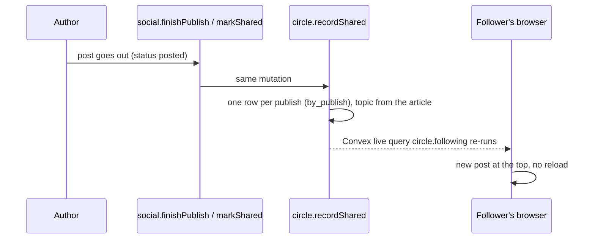

# The Circle — design

## Data
- `users`: `profilePublic`, `publicSlug` (existing), `displayName` (existing), `bio` (≤160), `followerCount`,
  `followingCount`, `sharedCount`, `lastSharedAt`; index `by_profilePublic [profilePublic, lastSharedAt]`.
- `follows { followerId, followeeId, createdAt }`: `by_follower`, `by_followee`, `by_pair`.
- `sharedPosts { userId, publishId, platform, text, url?, itemTitle?, itemLink?, imageUrl?, feedTitle?, feedUrl?, topic, postedAt }`:
  `by_user_posted`, `by_topic_posted`, `by_publish` (idempotency).

## Flow

## Reads
- `following`: follows by_follower (≤500) → each author's latest 10 via `by_user_posted` → merge newest first, 50.
- `inMyTopics`: topics = `topicsOfInterests(interests)` ∪ top read topics (3+ of the last 150 articles) →
  `by_topic_posted` (30 per topic) → public authors, not me, not followed.
- `people`: `by_profilePublic` (100, most recently active) ranked by shared topics, then recency.
- `profile(slug)`: null for private profiles unless it is the caller's own.

Visibility is decided at read time by `authorOf(user)` (public + slug + display name), so there is no copy to clean up
when someone opts out.
