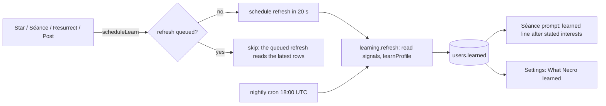

# Learning memory — design

Written after implementation (Nov 23–24, 2026, with Claude Code), to keep this spec complete alongside the code.

## Data
All on the `users` row, never in a shared table:
- `learned { topics: [{ topic, share }], terms: string[], feeds: string[], signals, updatedAt }`
- `learningOff` (user switch), `learnedResetAt` (actions before it are ignored), `learnQueuedAt` (coalescing).

## Signals and weights (`backend/lib/ai/learn.ts`)
| Action | Weight | Source rows |
|---|---|---|
| Posted | 5 | `publishes` with status `posted` (latest 100) |
| Drafted (Resurrect) | 3 | `drafts` (one per article, latest 100) |
| Starred | 3 | `items.by_user_starred` (latest 100) |
| Summarised (Séance) | 1 | `seances.by_user` (latest 200) |

Each weight decays with a 30-day half-life. Topics keep their share of engagement (≥ 5%), subjects are title words
seen in 2+ articles (stop words removed), sources are the feeds with the most weight. Below 3 actions nothing is sent.

## Flow

## Prompt use
- Séance: `learnedContext()` adds one line after the stated interests; the system prompt weighs stated interests first.
- Resurrect: the user's real published posts (`sharedPosts`, latest 3) fill the voice examples when fewer than 3 samples were saved.

## Privacy
Scoped to one user, never in any public view, shown in full in Settings ("Show exactly what the AI receives"),
can be switched off (the AI then sees only typed interests) or reset.
