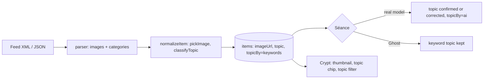

# Article images, topics and honest AI labels — design

Written after implementation (Nov 23–24, 2026, with Claude Code), to keep this spec complete alongside the code.

## Images (`backend/lib/feeds/image.ts`)
Candidates come from the parser with a source priority: 0 `media:content`, 1 `media:thumbnail`, 2 image enclosure
(RSS `enclosure`, Atom `link rel="enclosure"`, JSON Feed attachments), 3 `itunes:image`; JSON Feed `image`/`banner_image`
map to 0/1. Within a priority the widest wins; with no candidate, the first `` in the sanitised body that is not a
1–2 px pixel. `safeImageUrl` resolves relative URLs, upgrades http to https, rejects `data:`, `javascript:`, credentials
and tracker paths (`/pixel.gif`, `/1x1.png`, FeedBurner `/~r/`). Stored as `items.imageUrl`. The UI uses a lazy
`` that removes itself on error, and skips the lead image when the body already shows it.

## Topics (`backend/lib/topics.ts`)
Ten topics: AI, Security, Web & dev, Tech & gadgets, Design, Science, Business, News, Creators, Other.
Score = 3 × matches in feed categories + 2 × in the title + 1 × in the excerpt (capped), whole words only
(`(?<![\p{L}\p{N}])…(?![\p{L}\p{N}])`, so "ai" never matches "said"). Highest score wins, ties go to the more specific
topic, below 2 it is Other. Stored as `items.topic` with `topicBy: "keywords"`; index `by_user_topic` serves the
Crypt topic filter. The Séance schema requires `topic` (strict structured output rejects optional fields); a real
model's answer replaces the keyword topic (`topicBy: "ai"`), Ghost mode keeps it. `items.backfillMedia` (optionally
`reclassify`) updates older articles in pages of 200.

## Honest labels (`backend/lib/ai/modelName.ts`, `frontend/components/ui/model-badge.tsx`)
`modelLabel("groq:openai/gpt-oss-120b")` → "GPT OSS 120B · Groq"; `ghost:*` → null, shown as "Written without AI".
`<ModelBadge>` sits under the Séance, Resurrect drafts, Second Opinion, Grimoire and image captions; the caption
action returns the model it used, and the composer adds "AI can misread a picture. Check the caption matches your image."

## Flow

