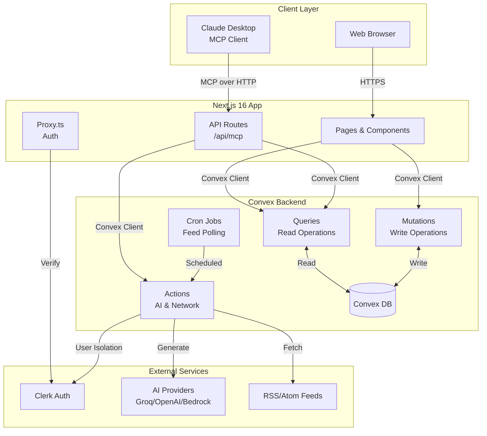
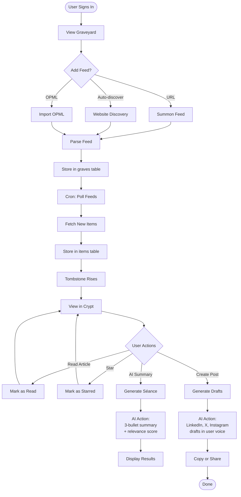
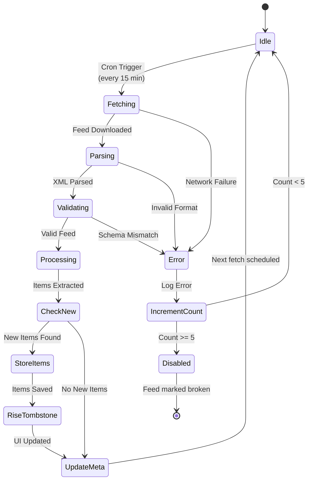
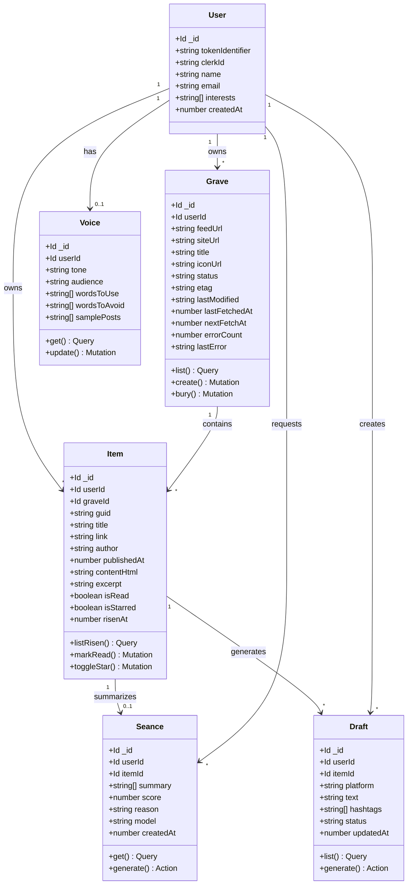
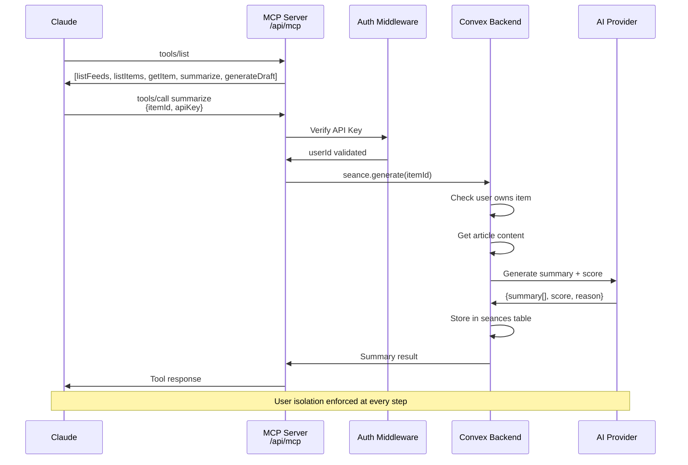

# Necro

**RSS, resurrected with AI.** A Kiroween 2026 project (category: Resurrection) by Mowlid Haibe · a Faafi project.

Necro turns your feeds into tombstones that rise when something new is published, gives you a calm reader, summarises articles with AI (Séance), drafts social posts in your voice (Resurrect), and lets Claude talk to your feeds over MCP.

Full product and system design: [`docs/Necro_Project_Documentation.md`](docs/Necro_Project_Documentation.md) · Brand: [`docs/Necro_Brand_Guide.md`](docs/Necro_Brand_Guide.md) · Kiro usage log: [`docs/KIRO_LOG.md`](docs/KIRO_LOG.md)

## Stack

Bun · Next.js 16 (App Router) · TypeScript strict · Tailwind CSS v4 · shadcn/ui · Motion · Convex · Clerk · Vercel AI SDK (Groq + OpenRouter with fallback) · Zod · Vitest + fast-check + convex-test

## Project layout

Two apps, each with its own `package.json`, `bun.lock` and `node_modules`. Bun only.

```
frontend/   Next.js app (UI, Clerk, /api routes). Deploys to Vercel.
backend/    Convex: schema, queries, mutations, actions, crons
            + lib/ (feed engine, SSRF-safe fetcher, AI layer, prompts) + tests/
docs/       Product docs, brand guide, Kiro log
.kiro/      Kiro steering, hooks and agents
```

The frontend imports the generated Convex API as `@backend/convex/_generated/api`.

**MCP (Talk to the Dead):** `POST /api/mcp` with a personal API key exposes 11 tools over your graveyard. Setup and tool list: [`docs/MCP.md`](docs/MCP.md).

## Setup

Requires [Bun](https://bun.sh) 1.3+.

```bash
cd backend  && bun install && cp .env.example .env.local
cd ../frontend && bun install && cp .env.example .env.local
```

1. **Convex:** in `backend/`, run `bunx convex dev` once. It links the project and writes `CONVEX_DEPLOYMENT`.
2. **Clerk:** copy the publishable and secret keys into `frontend/.env.local`, set `CLERK_JWT_ISSUER_DOMAIN` (both files) to its Frontend API URL, and turn on the **Convex** integration in the Clerk dashboard.
3. **Backend secrets:** fill in `backend/.env.local` (AI keys, models, server secrets), then push them to Convex:

   ```bash
   cd backend && bun run env:push
   ```

4. Check the AI models work: `bunx convex run aiNode:healthCheck`.

## Run

```bash
cd backend  && bun run dev   # terminal 1: Convex backend + codegen
cd frontend && bun run dev   # terminal 2: http://localhost:3000
```

## Scripts

| Folder | Command | Does |
|---|---|---|
| frontend | `bun run dev` / `build` | Next.js dev server / production build |
| frontend | `bun run check` | ESLint + `tsc --noEmit` |
| backend | `bun run dev` | `convex dev` (deploys functions to the dev deployment, regenerates types) |
| backend | `bun run test` | Vitest: unit, property-based (fast-check), convex-test |
| backend | `bun run check` | typecheck + tests |
| backend | `bun run env:push` | Push `backend/.env.local` secrets to Convex (`-- --prod` for production) |

## Architecture & Diagrams

### System Architecture



### Application Workflow



### Activity Diagram - Feed Processing



### Class Diagram - Core Entities



### MCP Integration Flow



## Data model

<!-- data-model:start -->
| Table | Key fields | Indexes |
|---|---|---|
| `users` | tokenIdentifier, clerkId, name, email, interests[], createdAt | by_token |
| `graves` | userId, feedUrl, siteUrl, title, iconUrl, status, etag, lastModified, lastFetchedAt, nextFetchAt, errorCount, lastError | by_user, by_user_feedUrl, by_nextFetchAt |
| `items` | userId, graveId, guid, title, link, author, publishedAt, contentHtml, excerpt, isRead, isStarred, risenAt | by_user_risenAt, by_grave_guid, by_user_grave |
| `seances` | userId, itemId, summary[3], score, reason, model, createdAt | by_user, by_item |
| `drafts` | userId, itemId, platform, text, hashtags[], status, updatedAt | by_user, by_user_item |
| `voice` | userId, tone, audience, wordsToUse[], wordsToAvoid[], samplePosts[] | by_user |
| `apiKeys` | userId, name, hashedKey, prefix, lastUsedAt, revokedAt | by_user, by_hashedKey |
<!-- data-model:end -->

Every table except `users` is scoped by `userId`; `convex/lib/auth.ts` is the one isolation helper, and `tests/convex/isolation.test.ts` proves one user cannot read another's data.

## Kiro

Specs, steering, hooks and custom agents live in [`.kiro/`](.kiro) and are committed on purpose.

## License

[MIT](LICENSE) © 2026 Mowlid Haibe
