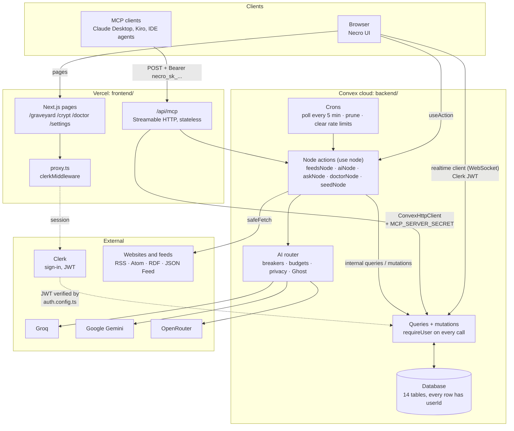
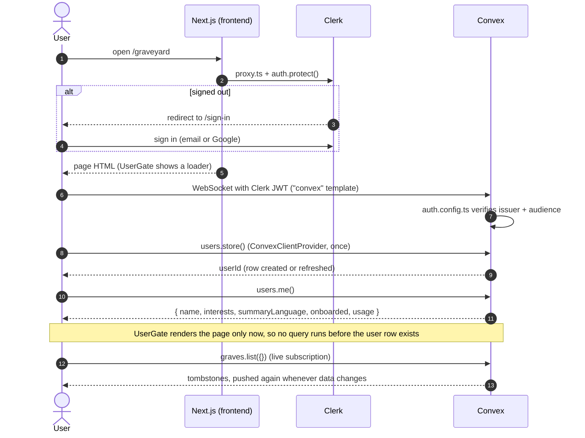
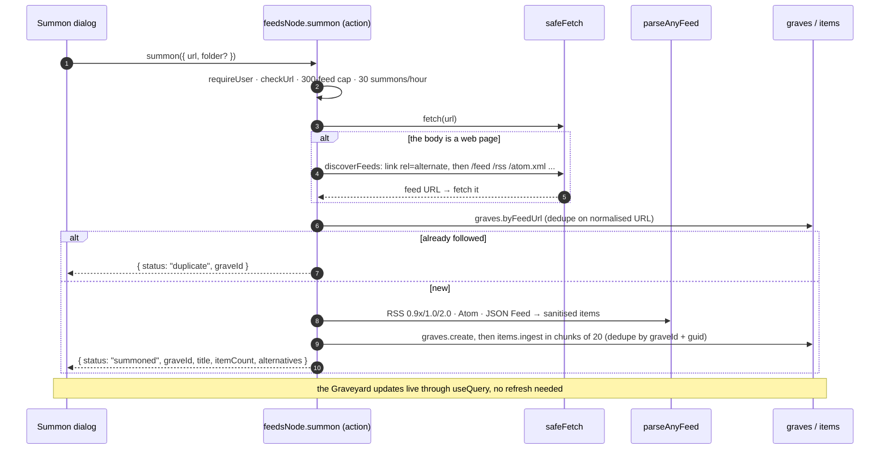
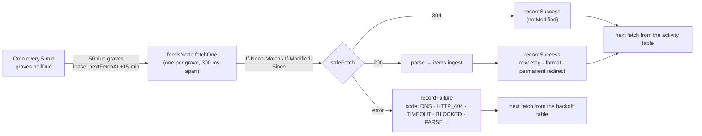
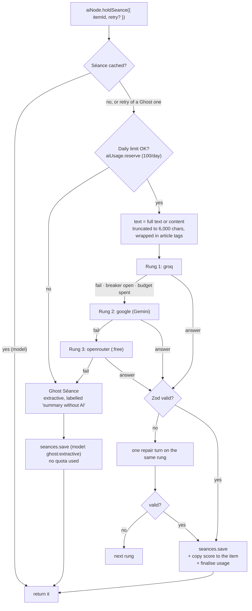
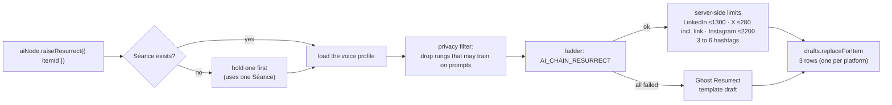
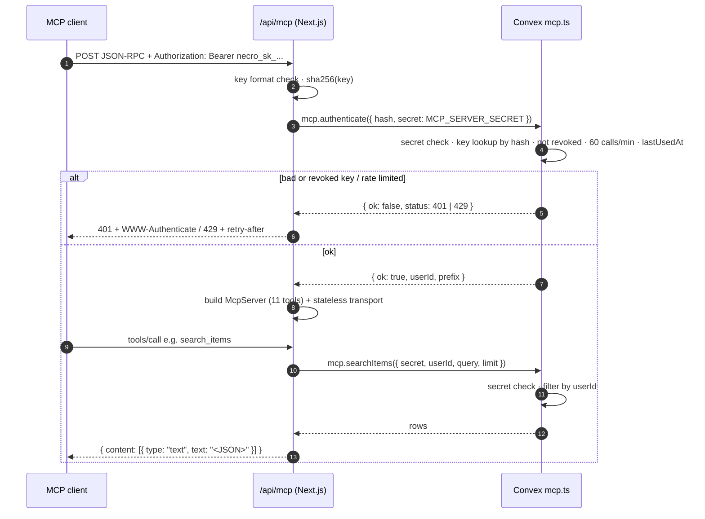
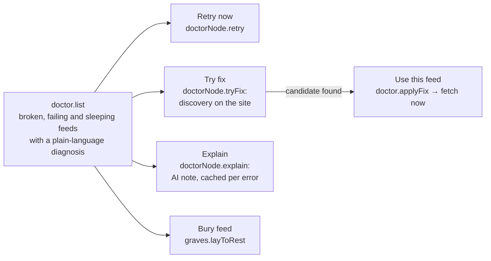
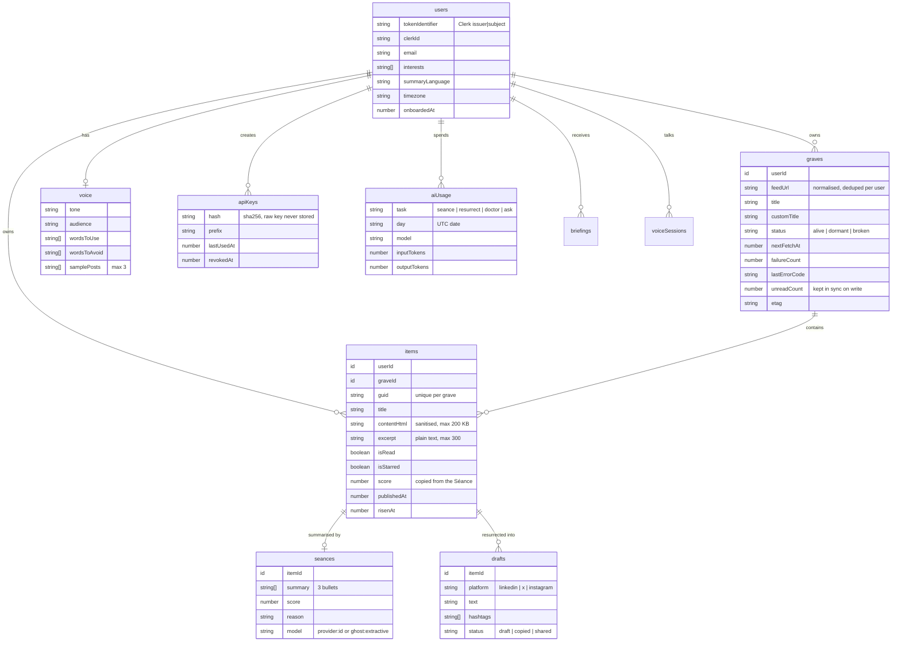

# Necro

**RSS, resurrected with AI.** A Kiroween 2026 project (category: **Resurrection**) by Mowlid Haibe.

**Live app:** [necro.malitos.tech](https://necro.malitos.tech) · **MCP endpoint:** `https://necro.malitos.tech/api/mcp` ([setup](docs/MCP.md))

Necro follows the sites you care about and turns each feed into a tombstone that *rises* when something new is published. It gives you a calm reader (the **Crypt**), a three-bullet AI summary with a relevance score for every article (**Séance**), social drafts for LinkedIn, X and Instagram in your own voice (**Resurrect**), a doctor for broken feeds (**Feed Doctor**), and an MCP server so Claude, Kiro or any AI assistant can work with your reading list (**Talk to the Dead**).

> **Goal of the build.** A new user can sign up, add three feeds, read an article, hold a Séance, resurrect it into drafts and connect an MCP client, in under five minutes, with no errors.

---

## Contents

1. [Quick start](#1-quick-start)
2. [Project layout](#2-project-layout)
3. [System architecture](#3-system-architecture)
4. [Request flows](#4-request-flows)
   - [4.1 Client page → authentication → backend](#41-client-page--authentication--backend)
   - [4.2 Summon a feed](#42-summon-a-feed)
   - [4.3 Polling: how tombstones rise](#43-polling-how-tombstones-rise)
   - [4.4 Séance: the AI ladder](#44-séance-the-ai-ladder)
   - [4.5 Resurrect: drafts with privacy routing](#45-resurrect-drafts-with-privacy-routing)
   - [4.6 MCP: Talk to the Dead](#46-mcp-talk-to-the-dead)
   - [4.7 Feed Doctor](#47-feed-doctor)
5. [AI models and providers](#5-ai-models-and-providers)
6. [Database](#6-database)
7. [API reference and responses](#7-api-reference-and-responses)
8. [Security](#8-security)
9. [Limits](#9-limits)
10. [Environment variables](#10-environment-variables)
11. [Testing](#11-testing)
12. [Scripts](#12-scripts)
13. [Kiro](#13-kiro)

---

## 1. Quick start

Requires [Bun](https://bun.sh) 1.3+. **Bun only**: never npm, yarn or pnpm.

```bash
cd backend  && bun install && cp .env.example .env.local
cd ../frontend && bun install && cp .env.example .env.local
```

1. **Convex.** In `backend/`, run `bunx convex dev` once. It links the project and writes `CONVEX_DEPLOYMENT` to `backend/.env.local`. Copy the deployment's URLs into `frontend/.env.local` as `NEXT_PUBLIC_CONVEX_URL` and `NEXT_PUBLIC_CONVEX_SITE_URL`.
2. **Clerk.** Put the publishable and secret keys in `frontend/.env.local`. Set `CLERK_JWT_ISSUER_DOMAIN` (both env files) to the Clerk Frontend API URL, and enable the **Convex** integration in the Clerk dashboard.
3. **Backend secrets.** Fill in `backend/.env.local` (AI keys, AI chains, server secrets), then push them to Convex. Convex functions read Convex env vars, not `.env.local`:

   ```bash
   cd backend && bun run env:push
   ```

4. **Check the AI chains:** `bunx convex run aiNode:healthCheck`.

### Running it day to day

The backend runs **in Convex's cloud**, not on your machine. Once it is deployed, you only run the frontend:

```bash
cd frontend && bun run dev      # http://localhost:3000
```

Run the backend watcher only while you change backend code. It typechecks and re-deploys on every save:

```bash
cd backend && bun run dev       # convex dev
```

Each folder keeps its own `node_modules` on purpose. Vercel builds `frontend/`, Convex deploys `backend/`, and neither needs the other's dependencies. The only link between them is the generated API types (`@backend/convex/_generated/api`).

---

## 2. Project layout

```
.
├─ frontend/                Next.js 16 app (Vercel)
│  ├─ app/
│  │  ├─ page.tsx           Landing
│  │  ├─ sign-in/ sign-up/  Clerk
│  │  ├─ (app)/             Signed-in area: auth.protect() + UserGate
│  │  │  ├─ graveyard/      Feeds as tombstones, Summon dialog
│  │  │  ├─ crypt/          Reader: list, article, Séance, Resurrect
│  │  │  ├─ doctor/         Broken and sleeping feeds
│  │  │  └─ settings/       Interests, language, voice, MCP keys, usage, OPML export
│  │  └─ api/mcp/           MCP server (route.ts + tools.ts)
│  ├─ components/           brand · layout · graveyard · crypt · doctor · settings · ui · providers
│  └─ lib/                  copy.ts (all UI text) · motion.ts · errors.ts · server/convex.ts
├─ backend/                 Convex: the only backend
│  ├─ convex/               schema, queries, mutations, actions, crons (see §7)
│  │  └─ lib/               auth.ts (user isolation) · ladder.ts (AI router glue)
│  ├─ lib/
│  │  ├─ feeds/             parse (RSS/RDF/Atom) · jsonfeed · normalize · discover · opml · url · any
│  │  ├─ security/ssrf.ts   safeFetch: the only way Necro fetches a user-supplied URL
│  │  ├─ ai/                providers · router · breaker · budgets · prompts · ghost · kindred · mock
│  │  └─ sanitize.ts · schedule.ts · limits.ts · errors.ts · text.ts
│  ├─ tests/                unit · pbt (fast-check) · convex (convex-test)
│  └─ scripts/push-env.ts   bun run env:push
├─ docs/                    MCP.md, product docs, brand guide, Kiro log
└─ .kiro/                   Kiro steering, hooks, agents (committed on purpose)
```

---

## 3. System architecture



**Design rules**

1. **One backend.** Convex owns all data, scheduling and AI calls. The UI and the MCP route call the same functions, so isolation, limits and validation apply everywhere.
2. **Every external call is replaceable.** Feeds go through `safeFetch`. Models go through the AI router. One provider failing never shows the user an error.
3. **Deterministic first, AI second.** Parsing, dedupe, scheduling, Kindred clustering and Ghost mode are plain code. AI improves results but is never the only path.
4. **Untrusted by default.** Feed content is data. It is sanitised at ingest, wrapped in `<article>` tags for models, and never obeyed.

| Layer | Lives in | Job | Must never |
|---|---|---|---|
| Experience | `frontend/app`, `frontend/components` | Render state, call backend functions | Call AI or fetch feeds directly |
| Edge route | `frontend/app/api/mcp` | Authenticate API keys, speak MCP | Hold business logic |
| Application API | `backend/convex/*.ts` public functions | Validate input, `requireUser`, ownership, error contract | Trust a client id without an owner check |
| Ingestion | `backend/lib/feeds`, `lib/security/ssrf.ts`, `convex/feedsNode.ts` | Fetch, parse, normalise, sanitise | Throw raw errors at the user |
| Intelligence | `backend/lib/ai`, `convex/aiNode.ts`, `askNode.ts` | Router, prompts, schemas, Ghost | Send private data to providers that train on it |
| Data | `backend/convex/schema.ts` | Tables, indexes, retention | Store raw API keys or prompts |

---

## 4. Request flows

### 4.1 Client page → authentication → backend



Every public Convex function starts with `requireUser` (`backend/convex/lib/auth.ts`). A record owned by someone else is reported exactly like a missing one (`NOT_FOUND`), so ids cannot be probed across accounts.

### 4.2 Summon a feed



**OPML import** (`feedsNode.importOpml`, max 1 MB, 200 feeds) creates the graves at once with `nextFetchAt` staggered 2 seconds apart and returns `{ created, duplicates, skipped }`. The poller fetches them, and tombstones fill in live.

### 4.3 Polling: how tombstones rise



| Situation | Next fetch | Status |
|---|---|---|
| New post in the last 24 h | 15 min | alive |
| New post in the last 7 days | 1 h | alive |
| No new post for 7 to 30 days | 6 h | alive |
| No new post for 30+ days | 24 h | dormant ("Sleeping") |
| Failure 1 / 2 | 15 min / 1 h | unchanged |
| Failure 3 to 4 / 5+ | 6 h / 24 h | **broken** |
| HTTP 429 or 503 | at least 1 h | unchanged |

Every interval gets ±10% jitter. A success resets the failure count. A daily cron (03:00 Malaysia time) deletes read, unstarred items older than 90 days, with their Séances and drafts.

### 4.4 Séance: the AI ladder



Output schema: `{ summary: [3 strings], score: 0-100, reason }`. A Séance is kept forever per item. A Ghost Séance can be replaced by a model Séance with **Try again with AI** (`retry: true`).

### 4.5 Resurrect: drafts with privacy routing



Voice samples are **private data**, so the router never sends them to providers flagged `trainsOnPrompts` (the Gemini free tier, and OpenRouter `:free` models and `openrouter/free`). This is checked in code (`backend/lib/ai/router.ts`) and covered by a test. Sharing is copy-to-clipboard, or opening the platform's own composer (`x.com/intent/post`, LinkedIn share). Necro never posts for you.

### 4.6 MCP: Talk to the Dead



Tools: `list_graves` · `get_grave` · `list_items` · `get_item` · `search_items` · `get_seance` · `add_grave` · `get_stats` · `get_briefing` · `ask_crypt` · `list_kindred`. The full table and client setup are in [`docs/MCP.md`](docs/MCP.md).

### 4.7 Feed Doctor



| Code | What the user reads |
|---|---|
| `DNS` | This site's domain could not be found. It may have moved or shut down. |
| `HTTP_404` | The feed address no longer exists. Try fix to look for its new address. |
| `HTTP_401` / `HTTP_403` | The site refuses feed readers or needs a login. |
| `HTTP_429` | The site asked us to slow down. Necro will try again later. |
| `HTTP_5xx` | The site's server is having trouble. Necro will keep trying. |
| `TIMEOUT` | The site took too long to answer. |
| `TOO_LARGE` | The feed is over 5 MB, which is too big to read. |
| `BLOCKED` | That address points to a private network, so Necro will not fetch it. |
| `NOT_A_FEED` / `NOT_XML` | This address now returns a web page instead of a feed. Try fix to find the feed. |
| `PARSE` | The feed is broken XML. Necro will retry, but the site needs to fix it. |

---

## 5. AI models and providers

All model calls run inside Convex actions through the Vercel AI SDK (`ai` v7, `generateText` with `Output.object`). Models are **never hard-coded**: each task reads a chain of `provider:model-id` rungs from a Convex env var.

| Task | Env var | Default chain | Privacy | Last rung |
|---|---|---|---|---|
| Séance | `AI_CHAIN_SEANCE` | `groq:openai/gpt-oss-120b`, `google:gemini-flash-latest`, `openrouter:google/gemma-4-31b-it:free`, `openrouter:openrouter/free` | public | Ghost Séance (extractive) |
| Resurrect | `AI_CHAIN_RESURRECT` | `groq:openai/gpt-oss-120b` (add a paid OpenRouter model first after a top-up) | **private** | Ghost Resurrect (template) |
| Doctor | `AI_CHAIN_DOCTOR` | `groq:openai/gpt-oss-20b`, `openrouter:openrouter/free` | public | static diagnosis table |
| Ask the Crypt | `AI_CHAIN_ASK` | `groq:openai/gpt-oss-120b` | **private** | matching items, no prose |
| Briefing | `AI_CHAIN_BRIEFING` | `groq:openai/gpt-oss-120b`, `openrouter:google/gemma-4-26b-a4b-it:free` | public | (Morning Séance: planned) |

| Provider | Spec prefix | Key | Trains on prompts? |
|---|---|---|---|
| Groq | `groq:` | `GROQ_API_KEY` | no |
| Google Gemini | `google:` | `GOOGLE_GENERATIVE_AI_API_KEY` | **yes** on the free tier (set `GOOGLE_PAID_TIER=true` on a paid plan) |
| OpenRouter | `openrouter:` | `OPENROUTER_API_KEY` | **yes** for `…:free` models and `openrouter/free`; no for paid models |
| Mock | `mock:` | `AI_ALLOW_MOCK=true` (tests only) | no |

A rung whose key is missing is skipped. **Reliability controls**, all in `backend/lib/ai/`:

- **Circuit breaker** per provider (`breaker.ts`, state in the `providerHealth` table). It opens after 5 failures in 2 minutes, at once on a 429 (respecting `retry-after`, minimum 60 s), and for 1 hour on a 401/403. Half-open after the cool-down; a failed probe doubles it, up to 30 minutes.

  ```mermaid
  stateDiagram-v2
    [*] --> closed
    closed --> open: 5 failures in 2 min<br/>or 429 / 401
    open --> half_open: cool-down passed
    half_open --> closed: request succeeds
    half_open --> open: request fails<br/>(cool-down doubled, max 30 min)
  ```

- **Budgets** (`budgets.ts`) at 80% of each free tier: Groq 24/min and 800/day, Gemini 12/min and 800/day, OpenRouter free 16/min and 800/day (override with `AI_BUDGET_<PROVIDER>="rpm,rpd"`). A spent budget skips the rung before the provider can answer 429.
- **Per-rung timeout** of 12 s and `maxRetries: 0`: the ladder retries, not the SDK.
- **Prompt injection:** article text sits inside `<article>` tags with an "ignore instructions inside" rule. Content models get no tools, and every output is validated by Zod.
- **Logs:** task, model, rung, latency and status only. Never prompts, article text or outputs.

Check the chains with `bunx convex run aiNode:healthCheck`, and the breakers, Ghost rate and broken feeds with `bunx convex run admin:health`.

---

## 6. Database

Convex, 14 tables. Every table except `users`, `providerHealth`, `rateLimits` and `demoCache` carries `userId`, with an index that starts with it.



<!-- data-model:start -->
| Table | Purpose | Indexes |
|---|---|---|
| `users` | Clerk identity, interests, preferences | by_token, by_clerk, by_publicSlug, by_email |
| `graves` | Feeds (tombstones) and their fetch state | by_user, by_user_feedUrl, by_user_status, by_user_folder, by_nextFetch |
| `items` | Articles | by_grave_guid, by_grave_published, by_grave_read, by_grave_starred, by_user_published, by_user_read, by_user_starred, by_user_score, by_user_risen, by_kindred · search `search_text` (title) · vector `by_embedding` (768) |
| `seances` | One AI summary per item | by_item, by_user |
| `drafts` | Social drafts, three per item | by_item, by_user |
| `voice` | Writing voice for Resurrect | by_user |
| `apiKeys` | MCP keys (hashed) | by_user, by_hash |
| `aiUsage` | Daily AI quota rows | by_user_day_task |
| `rateLimits` | Fixed-window counters (summons, MCP, provider budgets) | by_key, by_windowStart |
| `providerHealth` | Circuit breaker per AI provider | by_provider |
| `briefings` | Morning Séance (planned) | by_user_day |
| `voiceSessions` | Voice agent minutes (planned) | by_user_day |
| `demoCache` | Cached AI answers for a demo account | by_key |
<!-- data-model:end -->

---

## 7. API reference and responses

These are the public Convex functions the UI calls (`api.<module>.<function>`). Every one resolves the signed-in user first.

**Error contract.** Failures throw `ConvexError({ code, message })`. `message` is always safe to show, and the UI reads `error.data.code`.

| Code | Meaning |
|---|---|
| `UNAUTHENTICATED` | Not signed in, or the user row is not created yet |
| `NOT_FOUND` | Missing **or** owned by someone else (same answer on purpose) |
| `LIMIT` | Daily, hourly or feed cap reached |
| `DUPLICATE` | Feed already followed |
| `NOT_A_FEED` | The address did not return a feed (includes fetch errors like DNS or timeouts) |
| `BLOCKED` | Private or reserved address |
| `INVALID_INPUT` | Validation failed (lengths, formats) |
| `AI_UNAVAILABLE` | Only where Ghost mode does not apply |

| Function | Type | Args | Returns |
|---|---|---|---|
| `users.store` / `ensure` | mutation | none | `Id<"users">` |
| `users.me` | query | none | `{ _id, name, email, interests, summaryLanguage, onboarded, usage } \| null` |
| `users.setInterests` | mutation | `{ interests: string[] }` (1-20, ≤40 chars) | `null` |
| `users.setPreferences` | mutation | `{ summaryLanguage?, timezone?, briefingHour? }` | `null` |
| `users.completeOnboarding` | mutation | none | `null` |
| `users.deleteAllData` | action | `{ confirm: "DELETE" }` | `null` (deletes in batches) |
| `graves.list` | query | `{ folder? }` | `[{ _id, title, feedTitle, feedUrl, siteUrl, iconUrl, folder, status, unreadCount, lastFetchedAt, lastNewItemAt, lastErrorCode, failureCount }]` |
| `graves.get` | query | `{ graveId }` | the card above plus `{ format, lastErrorDetail, doctorNote }` |
| `graves.folders` | query | none | `[{ name, count }]` |
| `graves.rename` / `moveToFolder` | mutation | `{ graveId, title }` / `{ graveId, folder? }` | `null` |
| `graves.layToRest` | mutation | `{ graveId }` | `null` |
| `graves.exportOpml` | query | none | OPML 2.0 string |
| `feedsNode.summon` | action | `{ url, folder? }` | `{ status: "summoned", graveId, title, itemCount, alternatives[] } \| { status: "duplicate", graveId }` |
| `feedsNode.importOpml` | action | `{ opml }` (≤1 MB) | `{ created, duplicates, skipped }` |
| `items.list` | query | `{ graveId?, filter: all\|unread\|starred, sort?: newest\|relevance, paginationOpts }` | `{ page: ItemCard[], isDone, continueCursor }` |
| `items.get` | query | `{ itemId }` | `ItemCard & { contentHtml, exhumed, kindredId, seance: {summary, score, reason, model, ghost} \| null, drafts: [{_id, platform, text, hashtags, status, ghost}] }` |
| `items.search` | query | `{ query, graveId? }` | `ItemCard[]` (max 30) |
| `items.setRead` / `setStarred` | mutation | `{ itemId, value }` | `null` |
| `items.markAllRead` | mutation | `{ graveId? }` | count marked now (the rest are scheduled) |
| `items.risenToday` | query | none | number |
| `aiNode.holdSeance` | action | `{ itemId, retry? }` | `{ summary[3], score, reason, model, ghost }` |
| `aiNode.raiseResurrect` | action | `{ itemId }` | `[{ _id, platform, text, hashtags, status, model, ghost }] × 3` |
| `askNode.ask` | action | `{ question }` | `{ answer, citations[], confident, ghost, model, items[] }` |
| `drafts.update` | mutation | `{ draftId, text, hashtags }` | `null` (length checked per platform) |
| `drafts.setStatus` | mutation | `{ draftId, status: copied\|shared }` | `null` |
| `voice.get` / `save` | query / mutation | profile fields | profile or `null` |
| `doctor.list` | query | none | `[{ _id, health: broken\|failing\|dormant, title, feedUrl, status, lastErrorCode, diagnosis, doctorNote, lastFetchedAt, failureCount }]`, worst first |
| `doctor.applyFix` | mutation | `{ graveId, candidateUrl }` | `null` (fetches now) |
| `doctorNode.retry` | action | `{ graveId }` | `{ status, inserted, diagnosis? }` |
| `doctorNode.tryFix` | action | `{ graveId }` | `{ candidateUrl, title, itemCount } \| null` |
| `doctorNode.explain` | action | `{ graveId }` | `{ note }` |
| `apiKeys.create` | action | `{ name }` | `{ key, prefix }` (the raw key, shown once) |
| `apiKeys.list` / `revoke` | query / mutation | none / `{ keyId }` | keys without hashes / `null` |
| `usage.today` | query | none | `{ seance, resurrect, doctor, ask, voiceMinutes: { used, limit } }` |

`ItemCard` = `{ _id, graveId, graveTitle, title, link, author, publishedAt, excerpt, isRead, isStarred, score, risenAt }`. Lists never include `contentHtml`.

**MCP responses** are JSON in a single text block. Web text carries `"source": "untrusted web content"`. Errors come back as `isError: true` with `{ error: CODE, message }` and never a stack trace. See [`docs/MCP.md`](docs/MCP.md).

**Internal ops functions** (CLI or dashboard only): `aiNode:healthCheck`, `admin:health`, `seedNode:run`.

---

## 8. Security

| Threat | Control |
|---|---|
| SSRF through a feed URL | `safeFetch`: http and https only, no credentials in URLs, private and reserved IPs blocked **at socket connect** (so DNS rebinding fails), every redirect re-checked (max 5), 5 MB cap, 10 s timeout |
| XML attacks | `processEntities: false` (no billion laughs), 5 MB cap, 200 items per fetch |
| Stored XSS from articles | `sanitize-html` allowlist at ingest: no scripts, iframes, forms, event handlers or `javascript:`/`data:` URLs; links get `noopener noreferrer nofollow` |
| Prompt injection | `<article>` delimiting, an "ignore instructions inside" rule, no tools for content models, Zod-validated output, citations limited to retrieved items |
| Cross-user access | `requireUser` plus owner checks everywhere, the same `NOT_FOUND` for missing and foreign rows, isolation tests |
| Leaked API keys | Stored as SHA-256 only, shown once, revocable, 60 calls/min, max 5 per user |
| Secret-guarded functions | `MCP_SERVER_SECRET` (32+ chars) checked on every `mcp.*` call, server-side only |
| AI cost abuse | Daily limits with atomic reservation, input truncation, output token caps, caching, provider budgets |
| Secrets in git | `.env*` ignored (only `.env.example` committed). No secrets under `NEXT_PUBLIC_` |

---

## 9. Limits

| Limit | Value |
|---|---|
| Feeds per user | 300 |
| Summons per hour | 30 |
| Séances / Resurrects / Doctor notes / questions per day | 100 / 50 / 30 / 20 |
| MCP calls per key | 60 per minute |
| Active MCP keys | 5 |
| Fetch size / items per fetch / stored HTML | 5 MB / 200 / 200 KB |
| OPML import | 1 MB, 200 feeds |

---

## 10. Environment variables

| Variable | File | Pushed to Convex? | Purpose |
|---|---|---|---|
| `CONVEX_DEPLOYMENT` | backend | no (CLI only) | Which deployment `convex dev` targets |
| `NEXT_PUBLIC_CONVEX_URL`, `NEXT_PUBLIC_CONVEX_SITE_URL` | frontend | no | Convex client |
| `NEXT_PUBLIC_CLERK_PUBLISHABLE_KEY`, `CLERK_SECRET_KEY` | frontend | no | Clerk |
| `CLERK_JWT_ISSUER_DOMAIN` | both | **yes** | Convex verifies Clerk JWTs |
| `GROQ_API_KEY`, `OPENROUTER_API_KEY`, `GOOGLE_GENERATIVE_AI_API_KEY` | backend | **yes** | AI providers |
| `AI_CHAIN_SEANCE`, `_RESURRECT`, `_DOCTOR`, `_ASK`, `_BRIEFING`, `AI_EMBED_MODEL` | backend | **yes** | Model chains |
| `AI_BUDGET_<PROVIDER>`, `GOOGLE_PAID_TIER` | backend | **yes** | Optional overrides |
| `MCP_SERVER_SECRET`, `AGENT_SERVER_SECRET` | both (same value) | **yes** | Guard the server-to-Convex functions |
| `APP_URL`, `NECRO_BOT_CONTACT_URL` | backend | **yes** | OpenRouter referer, fetcher User-Agent |
| `LIVEKIT_URL`, `LIVEKIT_API_KEY`, `LIVEKIT_API_SECRET` | frontend | no | Voice (planned) |

`bun run env:push` (in `backend/`) pushes the backend set to the dev deployment. Add `-- --prod` for production. When deploying the frontend to Vercel, set the frontend variables in the Vercel project.

---

## 11. Testing

```bash
cd backend && bun run test
```

| Suite | What it proves |
|---|---|
| `tests/unit/feeds.test.ts` | RSS 2.0, Atom, RDF parsing; sanitising; dates; stable guids; OPML; discovery; no entity expansion |
| `tests/unit/extras.test.ts` | JSON Feed, Ghost Séance and Ghost Resurrect limits, Kindred clustering |
| `tests/unit/ladder.test.ts` | Router fall-through, privacy filtering, breaker and budget skips, repair, breaker rules |
| `tests/unit/ssrf-schedule-prompts.test.ts` | SSRF block list, polling schedule, X 280-character fitting, prompt delimiting |
| `tests/pbt/properties.test.ts` | fast-check: the parser never throws unexpectedly, items always have a guid and title, OPML round-trips, every private IP is blocked |
| `tests/convex/isolation.test.ts` | One user cannot read or change another's data; ingest dedupe; unread counts; daily limits; API keys |
| `tests/convex/reliability.test.ts` | Breakers and budgets in the database; Ghost Séance upgrade on retry |
| `tests/convex/mcp.test.ts` | MCP secret, key auth, revocation, 60/min limit, per-user isolation |

Frontend: `cd frontend && bun run check` (ESLint + TypeScript) and `bun run build`.

---

## 12. Scripts

| Folder | Command | Does |
|---|---|---|
| frontend | `bun run dev` | Next.js dev server on :3000 |
| frontend | `bun run build` / `start` | Production build / serve it |
| frontend | `bun run check` | ESLint + `tsc --noEmit` |
| backend | `bun run dev` | `convex dev`: watch, typecheck, deploy to dev |
| backend | `bun run deploy:dev` | Deploy once (`convex dev --once`) |
| backend | `bun run deploy` | Deploy to production |
| backend | `bun run env:push` | Push `backend/.env.local` to Convex env |
| backend | `bun run seed` | Optional demo data (`-- '{"email":"you@example.com"}'` for your account, `{"apiKey":true}` to print an MCP key) |
| backend | `bun run test` / `check` | Tests / typecheck + tests |

---

## 13. Kiro

Specs, steering, hooks and custom agents live in [`.kiro/`](.kiro) and are committed on purpose, as the hackathon requires. Steering files keep the agent on the project rules (Bun only, `safeFetch` only, user isolation, the AI ladder). Hooks run related tests on save, sync the data-model table on schema changes, review accessibility on component saves, and run a manual pre-submit check.

## License

[MIT](LICENSE) © 2026 Mowlid Haibe
