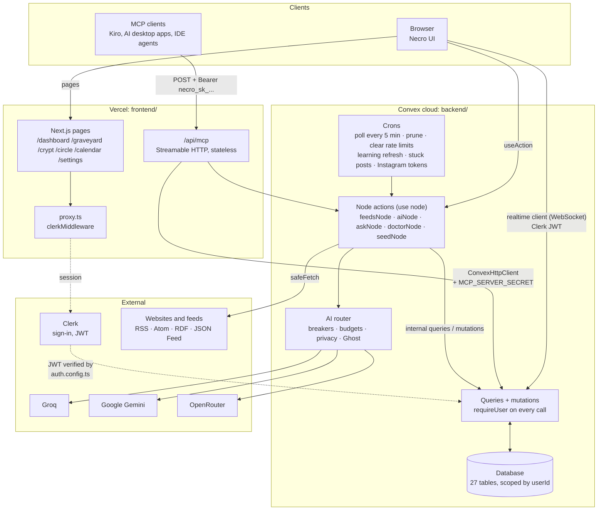
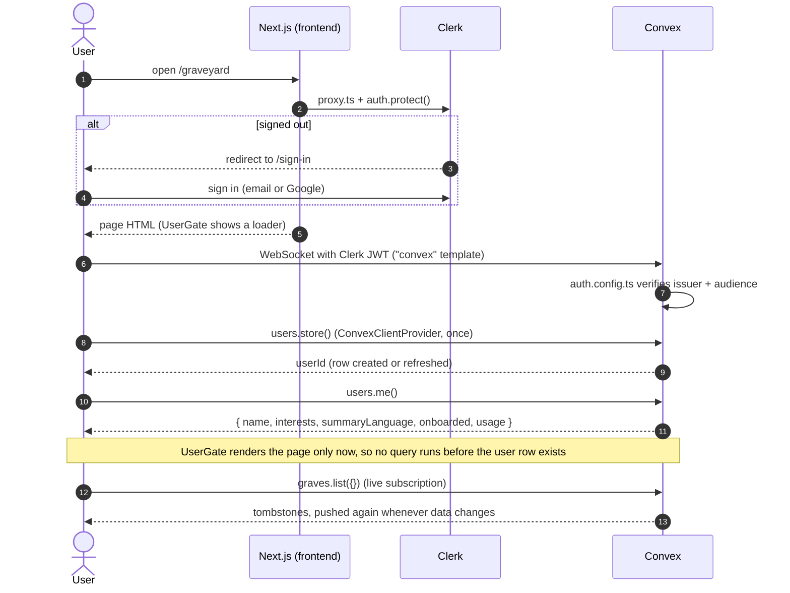
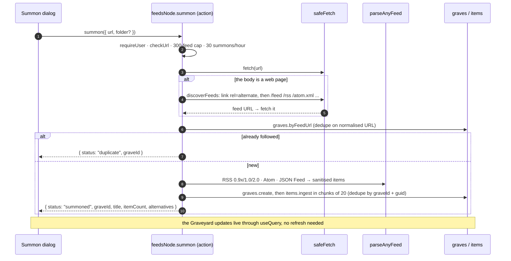
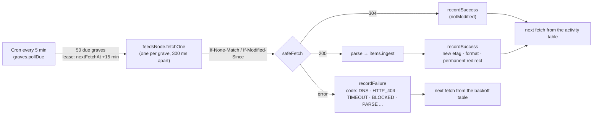
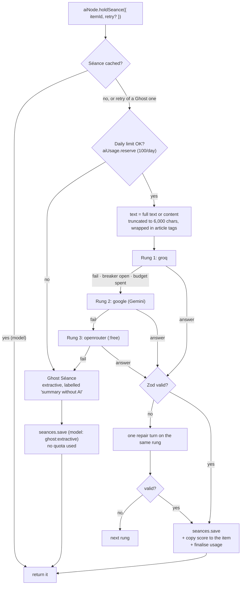
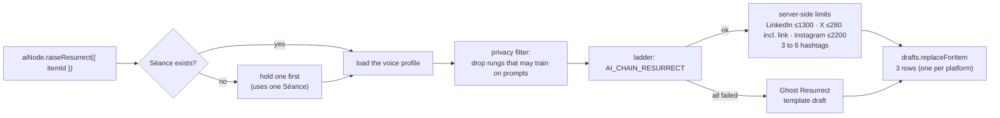
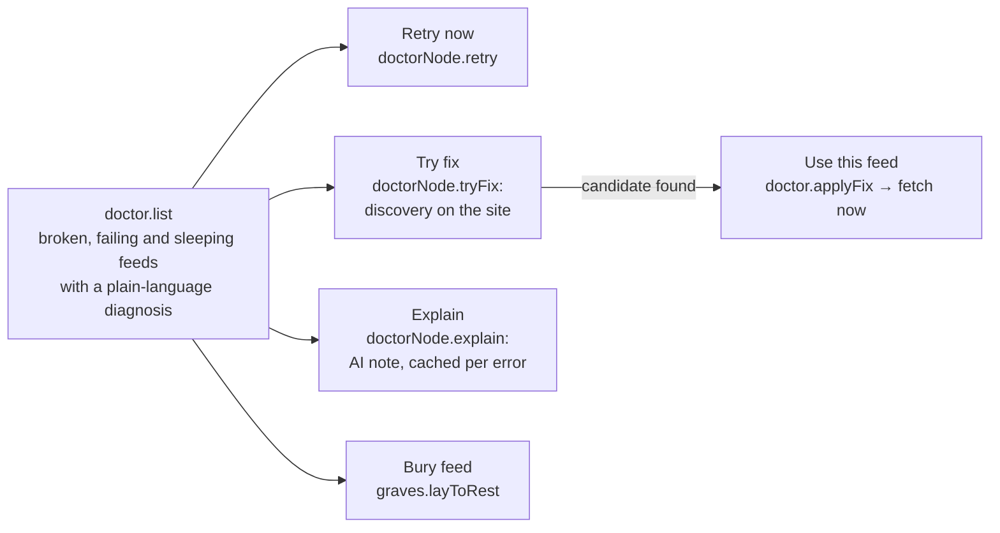
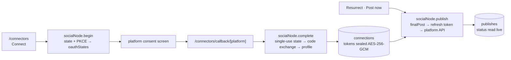
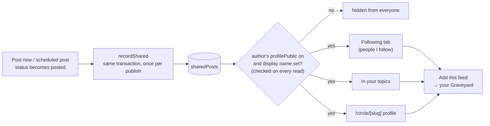
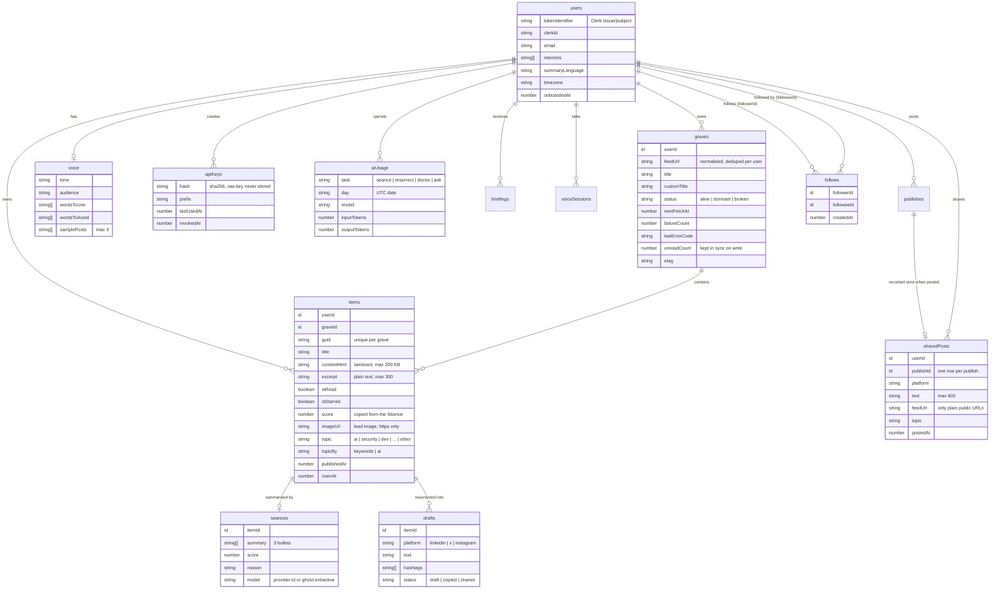

# Necro

**RSS, resurrected with AI.** A Kiroween 2026 project (category: **Resurrection**) by Mowlid Haibe ([@mawlid1431](https://github.com/mawlid1431)) and Arsikin Samaeng ([@ArsiKinS](https://github.com/arsikins)), from [Barkulanhub](https://barkulanhub.com).

**Live app:** [necro.malitos.tech](https://necro.malitos.tech) · **MCP endpoint:** `https://necro.malitos.tech/api/mcp` ([setup](docs/MCP.md))

Necro follows the sites you care about and turns each feed into a tombstone that *rises* when something new is published. It gives you a calm reader (the **Crypt**), a three-bullet AI summary with a relevance score for every article (**Séance**), social drafts for LinkedIn, X, Instagram and TikTok in your own voice (**Resurrect**), posted straight to your own accounts from **Connectors** with a preview that matches the real post, planned in **Witching Hour** (a live calendar with scheduling, reminders and a composer for your own images with AI captions), all summed up on your **Home** dashboard, a doctor for broken feeds (**Feed Doctor**), and an MCP server so Kiro or any AI assistant can work with your reading list (**Talk to the Dead**).

Every article now carries its lead **image** and one **topic** (AI, Security, Web & dev, Tech & gadgets, Design, Science, Business, News, Creators, Other) that you can filter by. Every AI answer says **who wrote it** ("Written by GPT OSS 120B · Groq", or "Written without AI" in Ghost mode). **The Circle** lets you follow people and see the posts they actually published through Necro, each with its RSS source one click away. A **learning memory** builds a small profile from what you post, draft, star and summarise, shows it to you in Settings, and adds it to the AI prompt as context.

### The real-world problem

People who **read to create** (creators, marketers, students, researchers, founders) follow dozens of sources and are expected to share what they learn. Today that means social feeds ranked by an algorithm, dozens of open tabs, and copy-pasting into four different apps. RSS still exists on almost every blog, newsroom and channel, but the good way to use it died with the classic feed readers.

Necro closes the whole loop in one calm place: **follow** any site (or bring back an old OPML export) → **read** chronologically → **understand** with a three-line AI summary ranked by your interests → **share** a post in your own voice to LinkedIn, X, Instagram and TikTok, previewed exactly as it will appear. It also lets your AI assistant read your sources through MCP.

> **Goal of the build.** A new user can sign up, add three feeds, read an article, hold a Séance, resurrect it into drafts and connect an MCP client, in under five minutes, with no errors.

---

## Contents

1. [Quick start](#1-quick-start)
2. [Project layout](#2-project-layout)
3. [System architecture](#3-system-architecture)
4. [Request flows](#4-request-flows)
   - [4.1 Client page → authentication → backend](#41-client-page--authentication--backend)
   - [4.2 Summon a feed](#42-summon-a-feed)
   - [4.3 Polling: how tombstones rise](#43-polling-how-tombstones-rise)
   - [4.4 Séance: the AI ladder](#44-séance-the-ai-ladder)
   - [4.5 Resurrect: drafts with privacy routing](#45-resurrect-drafts-with-privacy-routing)
   - [4.8 Connectors: post to LinkedIn, X, Instagram and TikTok](#48-connectors-post-to-linkedin-x-instagram-and-tiktok)
   - [4.9 Witching Hour, Home and "one post, once"](#49-witching-hour-home-and-one-post-once)
   - [4.10 Images, topics and honest AI labels](#410-images-topics-and-honest-ai-labels)
   - [4.11 The Circle: follow people](#411-the-circle-follow-people)
   - [4.12 Learning memory](#412-learning-memory)
   - [4.13 Navigation, landing page and screen sizes](#413-navigation-landing-page-and-screen-sizes)
   - [4.6 MCP: Talk to the Dead](#46-mcp-talk-to-the-dead)
   - [4.7 Feed Doctor](#47-feed-doctor)
5. [AI models and providers](#5-ai-models-and-providers)
6. [Database](#6-database)
7. [API reference and responses](#7-api-reference-and-responses)
8. [Security](#8-security)
9. [Limits](#9-limits)
10. [Environment variables](#10-environment-variables)
11. [Testing](#11-testing)
12. [Scripts](#12-scripts)
13. [Kiro](#13-kiro)

---

## 1. Quick start

Requires [Bun](https://bun.sh) 1.3+. **Bun only**: never npm, yarn or pnpm.

```bash
cd backend  && bun install && cp .env.example .env.local
cd ../frontend && bun install && cp .env.example .env.local
```

1. **Convex.** In `backend/`, run `bunx convex dev` once. It links the project and writes `CONVEX_DEPLOYMENT` to `backend/.env.local`. Copy the deployment's URLs into `frontend/.env.local` as `NEXT_PUBLIC_CONVEX_URL` and `NEXT_PUBLIC_CONVEX_SITE_URL`.
2. **Clerk.** Put the publishable and secret keys in `frontend/.env.local`. Set `CLERK_JWT_ISSUER_DOMAIN` (both env files) to the Clerk Frontend API URL, and enable the **Convex** integration in the Clerk dashboard.
3. **Backend secrets.** Fill in `backend/.env.local` (AI keys, AI chains, server secrets), then push them to Convex. Convex functions read Convex env vars, not `.env.local`:

   ```bash
   cd backend && bun run env:push
   ```

4. **Check the AI chains:** `bunx convex run aiNode:healthCheck`.

### Running it day to day

The backend runs **in Convex's cloud**, not on your machine. Once it is deployed, you only run the frontend:

```bash
cd frontend && bun run dev      # http://localhost:3000
```

Run the backend watcher only while you change backend code. It typechecks and re-deploys on every save:

```bash
cd backend && bun run dev       # convex dev
```

Each folder keeps its own `node_modules` on purpose. Vercel builds `frontend/`, Convex deploys `backend/`, and neither needs the other's dependencies. The only link between them is the generated API types (`@backend/convex/_generated/api`).

---

## 2. Project layout

```
.
├─ frontend/                Next.js 16 app (Vercel)
│  ├─ app/
│  │  ├─ page.tsx           Landing (hero, how it works, showcase, who it's for, FAQ)
│  │  ├─ sign-in/ sign-up/  Clerk
│  │  ├─ (app)/             Signed-in area: auth.protect() + UserGate (layout sets `instant = false`)
│  │  │  ├─ dashboard/      Home: live overview, where sign-in lands
│  │  │  ├─ graveyard/      Feeds as tombstones, Summon dialog, Broken feeds tab (Feed Doctor)
│  │  │  ├─ discover/       Shared feed collections (Covens)
│  │  │  ├─ crypt/          Reader: list (topic filter, thumbnails), article, Séance, Resurrect
│  │  │  ├─ circle/         The Circle: Following · In your topics · People; [slug]/ profile pages
│  │  │  ├─ omens/          Topic alerts and the weekly newsletter (Grimoire)
│  │  │  ├─ calendar/       Witching Hour: calendar, composer
│  │  │  ├─ connectors/     OAuth callbacks for connected accounts
│  │  │  └─ settings/       Interests, voice, public profile, "What Necro learned", MCP keys, usage
│  │  └─ api/mcp/           MCP server (route.ts + tools.ts)
│  ├─ components/           brand · layout · landing · graveyard · crypt · circle · calendar · settings · ui (incl. model-badge) · providers
│  └─ lib/                  copy.ts (all UI text) · motion.ts · errors.ts · server/convex.ts
├─ backend/                 Convex: the only backend
│  ├─ convex/               schema, queries, mutations, actions, crons (see §7)
│  │  ├─ circle.ts          follows, shared posts, profiles (the Circle)
│  │  ├─ learning.ts        learning memory: refresh, Settings card, on/off, reset
│  │  ├─ seedCircle.ts      demo people for the Circle (names end in "(demo)")
│  │  └─ lib/               auth.ts (user isolation) · ladder.ts (AI router glue)
│  ├─ lib/
│  │  ├─ feeds/             parse (RSS/RDF/Atom) · jsonfeed · normalize · image (lead image) · discover · opml · url · any
│  │  ├─ topics.ts          deterministic topic classifier
│  │  ├─ security/ssrf.ts   safeFetch: the only way Necro fetches a user-supplied URL
│  │  ├─ ai/                providers · router · breaker · budgets · prompts · ghost · kindred · learn · modelName · mock
│  │  └─ sanitize.ts · schedule.ts · limits.ts · errors.ts · text.ts
│  ├─ tests/                unit · pbt (fast-check) · convex (convex-test)
│  └─ scripts/push-env.ts   bun run env:push
├─ docs/                    MCP.md, Kiro write-up and log, documentation PDF, connectors setup
└─ .kiro/                   Kiro steering, hooks, agents (committed on purpose)
```

---

## 3. System architecture



**Design rules**

1. **One backend.** Convex owns all data, scheduling and AI calls. The UI and the MCP route call the same functions, so isolation, limits and validation apply everywhere.
2. **Every external call is replaceable.** Feeds go through `safeFetch`. Models go through the AI router. One provider failing never shows the user an error.
3. **Deterministic first, AI second.** Parsing, dedupe, scheduling, Kindred clustering and Ghost mode are plain code. AI improves results but is never the only path.
4. **Untrusted by default.** Feed content is data. It is sanitised at ingest, wrapped in `<article>` tags for models, and never obeyed.

| Layer | Lives in | Job | Must never |
|---|---|---|---|
| Experience | `frontend/app`, `frontend/components` | Render state, call backend functions | Call AI or fetch feeds directly |
| Edge route | `frontend/app/api/mcp` | Authenticate API keys, speak MCP | Hold business logic |
| Application API | `backend/convex/*.ts` public functions | Validate input, `requireUser`, ownership, error contract | Trust a client id without an owner check |
| Ingestion | `backend/lib/feeds`, `lib/security/ssrf.ts`, `convex/feedsNode.ts` | Fetch, parse, normalise, sanitise | Throw raw errors at the user |
| Intelligence | `backend/lib/ai`, `convex/aiNode.ts`, `askNode.ts` | Router, prompts, schemas, Ghost | Send private data to providers that train on it |
| Data | `backend/convex/schema.ts` | Tables, indexes, retention | Store raw API keys or prompts |

---

## 4. Request flows

### 4.1 Client page → authentication → backend



Every public Convex function starts with `requireUser` (`backend/convex/lib/auth.ts`). A record owned by someone else is reported exactly like a missing one (`NOT_FOUND`), so ids cannot be probed across accounts.

### 4.2 Summon a feed



**OPML import** (`feedsNode.importOpml`, max 1 MB, 200 feeds) creates the graves at once with `nextFetchAt` staggered 2 seconds apart and returns `{ created, duplicates, skipped }`. The poller fetches them, and tombstones fill in live.

### 4.3 Polling: how tombstones rise



| Situation | Next fetch | Status |
|---|---|---|
| New post in the last 24 h | 15 min | alive |
| New post in the last 7 days | 1 h | alive |
| No new post for 7 to 30 days | 6 h | alive |
| No new post for 30+ days | 24 h | dormant ("Sleeping") |
| Failure 1 / 2 | 15 min / 1 h | unchanged |
| Failure 3 to 4 / 5+ | 6 h / 24 h | **broken** |
| HTTP 429 or 503 | at least 1 h | unchanged |

Every interval gets ±10% jitter. A success resets the failure count. A daily cron (03:00 Malaysia time) deletes read, unstarred items older than 90 days, with their Séances and drafts.

### 4.4 Séance: the AI ladder



Output schema: `{ summary: [3 strings], score: 0-100, reason, topic? }`. The prompt lists the reader's stated interests first and, when learning memory has enough to say, the learned line second (see [4.12](#412-learning-memory)). When a real model answered, its `topic` replaces the keyword guess on the item (`topicBy: "ai"`). A Séance is kept forever per item. A Ghost Séance can be replaced by a model Séance with **Try again with AI** (`retry: true`).

### 4.5 Resurrect: drafts with privacy routing



Voice samples are **private data**, so the router never sends them to providers flagged `trainsOnPrompts` (the Gemini free tier, and OpenRouter `:free` models and `openrouter/free`). This is checked in code (`backend/lib/ai/router.ts`) and covered by a test. Sharing is **Post now** through a connected account (see [4.8](#48-connectors-post-to-linkedin-x-instagram-and-tiktok)), or by hand: copy-to-clipboard and the platform's own composer (`x.com/intent/post`, LinkedIn share). Necro only posts when you press the button.

### 4.6 MCP: Talk to the Dead

```mermaid
sequenceDiagram
  autonumber
  participant CL as MCP client
  participant R as /api/mcp (Next.js)
  participant CX as Convex mcp.ts
  CL->>R: POST JSON-RPC + Authorization: Bearer necro_sk_...
  R->>R: key format check · sha256(key)
  R->>CX: mcp.authenticate({ hash, secret: MCP_SERVER_SECRET })
  CX->>CX: secret check · key lookup by hash · not revoked · 60 calls/min · lastUsedAt
  alt bad or revoked key / rate limited
    CX-->>R: { ok: false, status: 401 | 429 }
    R-->>CL: 401 + WWW-Authenticate  /  429 + retry-after
  else ok
    CX-->>R: { ok: true, userId, prefix }
    R->>R: build McpServer (13 read tools; +3 write tools for read-and-write keys) + stateless transport
    CL->>R: tools/call e.g. search_items
    R->>CX: mcp.searchItems({ secret, userId, query, limit })
    CX->>CX: secret check · filter by userId
    CX-->>R: rows
    R-->>CL: { content: [{ type: "text", text: "<JSON>" }] }
  end
```

Tools: `list_graves` · `get_grave` · `list_items` · `get_item` · `search_items` · `get_seance` · `add_grave` · `get_stats` · `get_briefing` · `ask_crypt` · `list_kindred` · `get_omens`. The full table and client setup are in [`docs/MCP.md`](docs/MCP.md).

### 4.7 Feed Doctor



| Code | What the user reads |
|---|---|
| `DNS` | This site's domain could not be found. It may have moved or shut down. |
| `HTTP_404` | The feed address no longer exists. Try fix to look for its new address. |
| `HTTP_401` / `HTTP_403` | The site refuses feed readers or needs a login. |
| `HTTP_429` | The site asked us to slow down. Necro will try again later. |
| `HTTP_5xx` | The site's server is having trouble. Necro will keep trying. |
| `TIMEOUT` | The site took too long to answer. |
| `TOO_LARGE` | The feed is over 5 MB, which is too big to read. |
| `BLOCKED` | That address points to a private network, so Necro will not fetch it. |
| `NOT_A_FEED` / `NOT_XML` | This address now returns a web page instead of a feed. Try fix to find the feed. |
| `PARSE` | The feed is broken XML. Necro will retry, but the site needs to fix it. |

---

### 4.8 Connectors: post to LinkedIn, X, Instagram and TikTok

Spec: [`.kiro/specs/connectors`](.kiro/specs/connectors) · setup and platform research: [`docs/specs/connectors.md`](docs/specs/connectors.md).



- **Preview = post.** `finalPost()` builds the one string used by the preview, the counter, Copy, the share link and the API call. Link cards come from the article's own Open Graph tags (what X and LinkedIn read); Instagram and TikTok get the same 1080×1080 image the preview shows, as a signed JPEG link.
- **Platforms.** LinkedIn Posts API (article card with uploaded thumbnail), X `POST /2/tweets`, Instagram Login content publishing (Business/Creator accounts), TikTok Content Posting API photo posts (with TikTok's required privacy, comments, disclosure and consent choices).
- **Tokens** never reach the browser. X and TikTok refresh on use, Instagram refreshes daily, LinkedIn asks to reconnect after 60 days.
- A platform without app keys shows **Coming soon** instead of failing.

### 4.9 Witching Hour, Home and "one post, once"

- **Home** (`/dashboard`, where sign-in lands; the logo always goes to the landing page `/`): a live overview of your feeds, unread and risen posts, your posts (up next and recent), connected accounts, AI tools used today and MCP keys, with a getting-started checklist and alerts that link to where you fix things (`backend/convex/dashboard.ts`).
- **Witching Hour** (`/calendar`): a month calendar and live timeline of every post. **Schedule for later** from Resurrect, or **New post** to upload your own JPG/PNG (Convex storage), write a caption or press **Write with AI** (a vision model looks at the image and writes in your saved voice), pick accounts, and post now or at a time. Connected accounts post on their own at that time (Convex scheduler); the others, and TikTok always, become **reminders**: the card turns due, the nav shows a badge, the browser notifies you, and **Share now** opens the share sheet with the image (`backend/convex/social.ts`, `socialNode.ts`, `captionNode.ts`).
- **One post, once.** Every post carries a content key (`backend/lib/social/dedupe.ts`): one per article per platform, or the same caption and image per platform. While a post with that key is going out, waiting or posted, the same post is refused, checked inside the same Convex transaction that creates it (so two clicks or two tabs cannot both pass) and again by the scheduled job before sending. Resurrect locks its buttons live when a platform already has the article. Cancelled and failed posts can be retried. A post stuck "posting" for 15 minutes is marked failed (never retried automatically: the platform may already have it).
- **Real time.** Every screen reads Convex live queries: a post scheduled in one tab, a reminder coming due, a cancel or an article read appears everywhere at once, without a reload. Time windows on Home ("rose today", "last 30 days") follow the page's clock, refreshed every minute.

### 4.10 Images, topics and honest AI labels

Spec: [`.kiro/specs/media-topics`](.kiro/specs/media-topics).

- **Lead image** (`backend/lib/feeds/image.ts`): one `https` image per article, picked in this order: Media RSS `media:content`, `media:thumbnail`, an image enclosure, `itunes:image`, the JSON Feed image (the widest one within a source), else the first real `` in the content. `data:` and `javascript:` URLs, URLs with credentials and tracking pixels are rejected; `http` is upgraded to `https`. Stored as `items.imageUrl`, shown as a thumbnail in the Crypt list and as the lead image in the reader. An image that fails to load hides itself.
- **Topic** (`backend/lib/topics.ts`): one of AI, Security, Web & dev, Tech & gadgets, Design, Science, Business, News, Creators, Other. Whole-word keyword matches are weighted by where they appear: feed categories ×3, title ×2, excerpt ×1. The Séance may confirm or correct it when a real model answered (`items.topicBy` is `"ai"` or `"keywords"`). The Crypt has a topic filter (index `by_user_topic`). `items.backfillMedia` fills in images and topics for older articles.
- **Who wrote it** (`backend/lib/ai/modelName.ts`, `frontend/components/ui/model-badge.tsx`): under the Séance, Resurrect drafts, Second Opinion, the Grimoire newsletter and image captions, a line reads "Written by *model* · *provider*" or "Written without AI" when Ghost mode answered. Captions also say: "AI can misread a picture. Check the caption matches your image before posting."

### 4.11 The Circle: follow people

Spec: [`.kiro/specs/circle`](.kiro/specs/circle). Code: `backend/convex/circle.ts`, `frontend/components/circle/`.



- **Opt-in.** A public profile is off by default and needs a display name. Turning it off hides the profile and its posts at once, because visibility is checked at every read.
- **What is shared.** Only posts that actually went out through Necro (publish status `posted`), recorded exactly once in the same transaction that marks them posted (`finishPublish` / `markShared`). Never drafts, reading history or the email. A feed URL is shown only if it is a plain public address (no query string, no credentials, no token-like path).
- **Pages.** `/circle` with tabs **Following** · **In your topics** · **People**; profiles at `/circle/[slug]`; Follow / Unfollow; **Add this feed** brings the post's RSS source into your Graveyard.
- **Limits.** Follow up to 500 people, at most 30 follows per minute. Deleting an account removes its follows in both directions and its shared posts.
- **Demo people** (`backend/convex/seedCircle.ts`): marked `isDemo`, names end in "(demo)".

### 4.12 Learning memory

Spec: [`.kiro/specs/learning`](.kiro/specs/learning). Code: `backend/lib/ai/learn.ts`, `backend/convex/learning.ts`.

Necro cannot retrain hosted models, so it learns the reader from their own actions instead:

| Action | Weight |
|---|---|
| Posted | 5 |
| Drafted | 3 |
| Starred | 3 |
| Summarised (Séance) | 1 |

Older actions fade with a 30-day half-life. The profile keeps topic shares, recurring subjects (seen in 2 or more articles) and top sources. Nothing is sent to the AI until there are at least 3 actions. The learned line goes into the Séance prompt after the stated interests, and the user's real published posts are used as voice examples for Resurrect when fewer than 3 samples are saved. It refreshes after actions (at most once per 10 minutes per user) and nightly by cron. **Settings › What Necro learned** shows the profile, the exact line the AI receives, an on/off switch and a reset.

### 4.13 Navigation, landing page and screen sizes

- **Nav:** Dashboard · Graveyard ▾ (Your feeds, Discover, Broken feeds) · Crypt · Circle · Omens ▾ (Topic alerts, Weekly newsletter) · Witching Hour ▾ (Calendar, New post, Connected accounts) · ⚙ Settings. Below 1024 px a hamburger menu opens a full-width sheet on phones and a panel on tablets, with 44 px rows, the current page highlighted and the background dimmed and locked.
- **Landing (`/`):** a hero with a plain one-line explanation, How it works (3 steps), Showcase (3 phone mockups), Who it's for, FAQ and a final call to action.
- **Screen sizes:** checked with no horizontal overflow on 8 pages at 13 widths from 320 px to 7680 px. The root font scales to 125% at 2560 px, 150% at 3520 px, 200% at 4800 px and 275% at 6720 px CSS width (`frontend/app/globals.css`), for QHD, 4K, 5K and 8K screens.
- **Real time, checked in a browser:** a new post by someone you follow appears at the top of Following without a reload; starring 3 articles in one tab updated "What Necro learned" in another; a topic change updated the Crypt list live.

## 5. AI models and providers

All model calls run inside Convex actions through the Vercel AI SDK (`ai` v7, `generateText` with `Output.object`). Models are **never hard-coded**: each task reads a chain of `provider:model-id` rungs from a Convex env var.

| Task | Env var | Default chain | Privacy | Last rung |
|---|---|---|---|---|
| Séance | `AI_CHAIN_SEANCE` | `groq:openai/gpt-oss-120b`, `google:gemini-flash-latest`, `openrouter:google/gemma-4-31b-it:free`, `openrouter:openrouter/free` | public | Ghost Séance (extractive) |
| Resurrect | `AI_CHAIN_RESURRECT` | `groq:openai/gpt-oss-120b` (add a paid OpenRouter model first after a top-up) | **private** | Ghost Resurrect (template) |
| Doctor | `AI_CHAIN_DOCTOR` | `groq:openai/gpt-oss-20b`, `openrouter:openrouter/free` | public | static diagnosis table |
| Ask the Crypt | `AI_CHAIN_ASK` | `groq:openai/gpt-oss-120b` | **private** | matching items, no prose |
| Briefing | `AI_CHAIN_BRIEFING` | `groq:openai/gpt-oss-120b`, `openrouter:google/gemma-4-26b-a4b-it:free` | public | (Morning Séance: planned) |

| Provider | Spec prefix | Key | Trains on prompts? |
|---|---|---|---|
| Groq | `groq:` | `GROQ_API_KEY` | no |
| Google Gemini | `google:` | `GOOGLE_GENERATIVE_AI_API_KEY` | **yes** on the free tier (set `GOOGLE_PAID_TIER=true` on a paid plan) |
| OpenRouter | `openrouter:` | `OPENROUTER_API_KEY` | **yes** for `…:free` models and `openrouter/free`; no for paid models |
| Mock | `mock:` | `AI_ALLOW_MOCK=true` (tests only) | no |

A rung whose key is missing is skipped. **Reliability controls**, all in `backend/lib/ai/`:

- **Circuit breaker** per provider (`breaker.ts`, state in the `providerHealth` table). It opens after 5 failures in 2 minutes, at once on a 429 (respecting `retry-after`, minimum 60 s), and for 1 hour on a 401/403. Half-open after the cool-down; a failed probe doubles it, up to 30 minutes.

  ```mermaid
  stateDiagram-v2
    [*] --> closed
    closed --> open: 5 failures in 2 min<br/>or 429 / 401
    open --> half_open: cool-down passed
    half_open --> closed: request succeeds
    half_open --> open: request fails<br/>(cool-down doubled, max 30 min)
  ```

- **Budgets** (`budgets.ts`) at 80% of each free tier: Groq 24/min and 800/day, Gemini 12/min and 800/day, OpenRouter free 16/min and 800/day (override with `AI_BUDGET_<PROVIDER>="rpm,rpd"`). A spent budget skips the rung before the provider can answer 429.
- **Per-rung timeout** of 12 s and `maxRetries: 0`: the ladder retries, not the SDK.
- **Prompt injection:** article text sits inside `<article>` tags with an "ignore instructions inside" rule. Content models get no tools, and every output is validated by Zod.
- **Logs:** task, model, rung, latency and status only. Never prompts, article text or outputs.

Check the chains with `bunx convex run aiNode:healthCheck`, and the breakers, Ghost rate and broken feeds with `bunx convex run admin:health`.

---

## 6. Database

Convex, 27 tables (including `connections`, `oauthStates`, `publishes`, `uploads` for Connectors and Witching Hour, and `follows`, `sharedPosts` for the Circle). Every table except `users`, `follows`, `providerHealth`, `rateLimits` and `demoCache` carries `userId`, with an index that starts with it; `follows` is indexed from both sides (`followerId`, `followeeId`). The learning memory lives on the user row (`users.learned`, `learningOff`, `learnedResetAt`).



<!-- data-model:start -->
| Table | Purpose | Indexes |
|---|---|---|
| `users` | Clerk identity, interests, preferences, public profile (`profilePublic`, `bio`, counters), learning memory (`learned`) | by_token, by_clerk, by_publicSlug, by_email, by_profilePublic |
| `follows` | The Circle: who follows whom, one row per pair | by_follower, by_followee, by_pair |
| `sharedPosts` | The Circle: posts that went out through Necro (status posted), recorded once | by_user_posted, by_topic_posted, by_publish |
| `graves` | Feeds (tombstones) and their fetch state | by_user, by_user_feedUrl, by_user_status, by_user_folder, by_nextFetch |
| `items` | Articles, with lead `imageUrl`, `topic` and `topicBy` | by_grave_guid, by_grave_published, by_grave_read, by_grave_starred, by_user_published, by_user_read, by_user_starred, by_user_score, by_grave_score, by_user_read_score, by_user_starred_score, by_user_risen, by_user_topic, by_kindred · search `search_text` (title) · vector `by_embedding` (768) |
| `kindredIndex` | Light title rows for Kindred clustering | by_user_published, by_item |
| `omens` / `omenMatches` | Topic alerts and their matches | by_user / by_user_seen, by_user_created, by_omen, by_omen_item, by_item |
| `opinions` | Second Opinion per Kindred group | by_user_kindred |
| `grimoires` | Weekly newsletter drafts | by_user |
| `collections` / `collectionFollows` / `collectionReports` | Covens: shared feed collections, follows, reports | by_user, by_slug, by_public_* · search `search_title` / by_user, by_collection, by_user_collection |
| `seances` | One AI summary per item | by_item, by_user |
| `drafts` | Social drafts, three per item | by_item, by_user |
| `voice` | Writing voice for Resurrect | by_user |
| `connections` | Connected social accounts; tokens sealed (AES-256-GCM) | by_user_platform, by_platform |
| `oauthStates` | Single-use OAuth state + PKCE verifier (15 min) | by_state, by_user |
| `publishes` | Every post, scheduled post and reminder with its live status and content key | by_user, by_user_key, by_user_at, by_user_status, by_status_since, by_item |
| `uploads` | Images uploaded in the composer (owner-checked) | by_user, by_storage |
| `apiKeys` | MCP keys (hashed) | by_user, by_hash |
| `aiUsage` | Daily AI quota rows | by_user_day_task |
| `rateLimits` | Fixed-window counters (summons, MCP, provider budgets) | by_key, by_windowStart |
| `providerHealth` | Circuit breaker per AI provider | by_provider |
| `briefings` | Morning Séance (planned) | by_user_day |
| `voiceSessions` | Voice agent minutes (planned) | by_user_day |
| `demoCache` | Cached AI answers for a demo account | by_key |
<!-- data-model:end -->

---

## 7. API reference and responses

These are the public Convex functions the UI calls (`api.<module>.<function>`). Every one resolves the signed-in user first.

**Error contract.** Failures throw `ConvexError({ code, message })`. `message` is always safe to show, and the UI reads `error.data.code`.

| Code | Meaning |
|---|---|
| `UNAUTHENTICATED` | Not signed in, or the user row is not created yet |
| `NOT_FOUND` | Missing **or** owned by someone else (same answer on purpose) |
| `LIMIT` | Daily, hourly or feed cap reached |
| `DUPLICATE` | Feed already followed |
| `NOT_A_FEED` | The address did not return a feed (includes fetch errors like DNS or timeouts) |
| `BLOCKED` | Private or reserved address |
| `INVALID_INPUT` | Validation failed (lengths, formats) |
| `AI_UNAVAILABLE` | Only where Ghost mode does not apply |

| Function | Type | Args | Returns |
|---|---|---|---|
| `users.store` / `ensure` | mutation | none | `Id<"users">` |
| `users.me` | query | none | `{ _id, name, email, interests, summaryLanguage, onboarded, usage } \| null` |
| `users.setInterests` | mutation | `{ interests: string[] }` (1-20, ≤40 chars) | `null` |
| `users.setPreferences` | mutation | `{ summaryLanguage?, timezone?, briefingHour? }` | `null` |
| `users.completeOnboarding` | mutation | none | `null` |
| `users.deleteAllData` | action | `{ confirm: "DELETE" }` | `null` (deletes in batches) |
| `graves.list` | query | `{ folder? }` | `[{ _id, title, feedTitle, feedUrl, siteUrl, iconUrl, folder, status, unreadCount, lastFetchedAt, lastNewItemAt, lastErrorCode, failureCount }]` |
| `graves.get` | query | `{ graveId }` | the card above plus `{ format, lastErrorDetail, doctorNote }` |
| `graves.folders` | query | none | `[{ name, count }]` |
| `graves.rename` / `moveToFolder` | mutation | `{ graveId, title }` / `{ graveId, folder? }` | `null` |
| `graves.layToRest` | mutation | `{ graveId }` | `null` |
| `graves.exportOpml` | query | none | OPML 2.0 string |
| `feedsNode.summon` | action | `{ url, folder? }` | `{ status: "summoned", graveId, title, itemCount, alternatives[] } \| { status: "duplicate", graveId }` |
| `feedsNode.importOpml` | action | `{ opml }` (≤1 MB) | `{ created, duplicates, skipped }` |
| `items.list` | query | `{ graveId?, filter: all\|unread\|starred, sort?: newest\|relevance, paginationOpts }` | `{ page: ItemCard[], isDone, continueCursor }` |
| `items.get` | query | `{ itemId }` | `ItemCard & { contentHtml, exhumed, kindredId, seance: {summary, score, reason, model, ghost} \| null, drafts: [{_id, platform, text, hashtags, status, ghost}] }` |
| `items.search` | query | `{ query, graveId? }` | `ItemCard[]` (max 30) |
| `items.setRead` / `setStarred` | mutation | `{ itemId, value }` | `null` |
| `items.markAllRead` | mutation | `{ graveId? }` | count marked now (the rest are scheduled) |
| `items.risenToday` | query | none | number |
| `aiNode.holdSeance` | action | `{ itemId, retry? }` | `{ summary[3], score, reason, model, ghost }` |
| `aiNode.raiseResurrect` | action | `{ itemId }` | `[{ _id, platform, text, hashtags, status, model, ghost }] × 3` |
| `askNode.ask` | action | `{ question }` | `{ answer, citations[], confident, ghost, model, items[] }` |
| `drafts.update` | mutation | `{ draftId, text, hashtags }` | `null` (length checked per platform) |
| `drafts.setStatus` | mutation | `{ draftId, status: copied\|shared }` | `null` |
| `voice.get` / `save` | query / mutation | profile fields | profile or `null` |
| `doctor.list` | query | none | `[{ _id, health: broken\|failing\|dormant, title, feedUrl, status, lastErrorCode, diagnosis, doctorNote, lastFetchedAt, failureCount }]`, worst first |
| `doctor.applyFix` | mutation | `{ graveId, candidateUrl }` | `null` (fetches now) |
| `doctorNode.retry` | action | `{ graveId }` | `{ status, inserted, diagnosis? }` |
| `doctorNode.tryFix` | action | `{ graveId }` | `{ candidateUrl, title, itemCount } \| null` |
| `doctorNode.explain` | action | `{ graveId }` | `{ note }` |
| `apiKeys.create` | action | `{ name }` | `{ key, prefix }` (the raw key, shown once) |
| `apiKeys.list` / `revoke` | query / mutation | none / `{ keyId }` | keys without hashes / `null` |
| `usage.today` | query | none | `{ seance, resurrect, doctor, ask, voiceMinutes: { used, limit } }` |

`ItemCard` = `{ _id, graveId, graveTitle, title, link, author, publishedAt, excerpt, isRead, isStarred, score, risenAt }`. Lists never include `contentHtml`.

**MCP responses** are JSON in a single text block. Web text carries `"source": "untrusted web content"`. Errors come back as `isError: true` with `{ error: CODE, message }` and never a stack trace. See [`docs/MCP.md`](docs/MCP.md).

**Internal ops functions** (CLI or dashboard only): `aiNode:healthCheck`, `admin:health`, `seedNode:run`.

---

## 8. Security

| Threat | Control |
|---|---|
| SSRF through a feed URL | `safeFetch`: http and https only, no credentials in URLs, private and reserved IPs blocked **at socket connect** (so DNS rebinding fails), every redirect re-checked (max 5), 5 MB cap, 10 s timeout |
| XML attacks | `processEntities: false` (no billion laughs), 5 MB cap, 200 items per fetch |
| Stored XSS from articles | `sanitize-html` allowlist at ingest: no scripts, iframes, forms, event handlers or `javascript:`/`data:` URLs; links get `noopener noreferrer nofollow` |
| Prompt injection | `<article>` delimiting, an "ignore instructions inside" rule, no tools for content models, Zod-validated output, citations limited to retrieved items |
| Cross-user access | `requireUser` plus owner checks everywhere, the same `NOT_FOUND` for missing and foreign rows, isolation tests |
| Leaked API keys | Stored as SHA-256 only, shown once, revocable, 60 calls/min, max 5 per user |
| Secret-guarded functions | `MCP_SERVER_SECRET` (32+ chars) checked on every `mcp.*` call, server-side only |
| AI cost abuse | Daily limits with atomic reservation, input truncation, output token caps, caching, provider budgets |
| Social account tokens | Official OAuth only (single-use state, PKCE on X); tokens sealed with AES-256-GCM, never returned to the browser; deleted on disconnect and account deletion |
| Post image misuse | `/api/post-image` needs a signed-in user or an HMAC-signed link valid for 1 hour |
| Article images | `https` only (http upgraded), no `data:`/`javascript:` URLs, no credentials in the URL, tracking pixels dropped; shown with no referrer and hidden if they fail to load |
| Circle privacy | Public profile off by default and needs a display name; visibility checked on every read, so turning it off hides everything at once; only posts that actually went out are shared, never drafts, reading or the email; feed URLs shown only when plain and public (no query, credentials or token-like path); 500 follows max, 30 per minute; account deletion removes follows both ways and shared posts |
| Learning memory | Built only from the user's own actions in Necro; shown in full (including the exact line sent to the AI) in Settings, can be switched off or reset; nothing is sent until there are 3+ actions |
| Secrets in git | `.env*` ignored (only `.env.example` committed). No secrets under `NEXT_PUBLIC_` |

---

## 9. Limits

| Limit | Value |
|---|---|
| Feeds per user | 300 |
| Summons per hour | 30 |
| Séances / Resurrects / Doctor notes / questions per day | 100 / 50 / 30 / 20 |
| MCP calls per key | 60 per minute |
| Active MCP keys | 5 |
| Fetch size / items per fetch / stored HTML | 5 MB / 200 / 200 KB |
| OPML import | 1 MB, 200 feeds |
| Post now | 30 per hour per user |
| Posts and reminders created (all paths) | 60 per hour per user; 100 scheduled at once; the same post only once per platform |
| Composer uploads | JPG/PNG up to 8 MB, 50 per day |
| AI captions | 30 per day |
| People followed (the Circle) | 500; at most 30 follows per minute |
| Profile bio | 160 characters |
| Learning memory | used once 3+ actions; refreshed at most every 10 minutes per user, plus nightly |

---

## 10. Environment variables

| Variable | File | Pushed to Convex? | Purpose |
|---|---|---|---|
| `CONVEX_DEPLOYMENT` | backend | no (CLI only) | Which deployment `convex dev` targets |
| `NEXT_PUBLIC_CONVEX_URL`, `NEXT_PUBLIC_CONVEX_SITE_URL` | frontend | no | Convex client |
| `NEXT_PUBLIC_CLERK_PUBLISHABLE_KEY`, `CLERK_SECRET_KEY` | frontend | no | Clerk |
| `CLERK_JWT_ISSUER_DOMAIN` | both | **yes** | Convex verifies Clerk JWTs |
| `GROQ_API_KEY`, `OPENROUTER_API_KEY`, `GOOGLE_GENERATIVE_AI_API_KEY` | backend | **yes** | AI providers |
| `AI_CHAIN_SEANCE`, `_RESURRECT`, `_DOCTOR`, `_ASK`, `_BRIEFING`, `AI_EMBED_MODEL` | backend | **yes** | Model chains |
| `AI_BUDGET_<PROVIDER>`, `GOOGLE_PAID_TIER` | backend | **yes** | Optional overrides |
| `MCP_SERVER_SECRET`, `AGENT_SERVER_SECRET` | both (same value) | **yes** | Guard the server-to-Convex functions |
| `APP_URL`, `NECRO_BOT_CONTACT_URL` | backend | **yes** | OpenRouter referer, fetcher User-Agent |
| `LIVEKIT_URL`, `LIVEKIT_API_KEY`, `LIVEKIT_API_SECRET` | frontend | no | Voice (planned) |
| `AI_CHAIN_CAPTION` | backend | **yes** | Optional: image-capable models for "Write with AI" (default: paid OpenRouter vision models) |
| `SOCIAL_TOKEN_KEY` | backend | **yes** | 32 random bytes (base64): seals connected-account tokens |
| `POST_IMAGE_SECRET` | both (same value) | **yes** | Signs the post-image links Instagram and TikTok fetch |
| `LINKEDIN_CLIENT_ID/SECRET`, `X_CLIENT_ID/SECRET`, `INSTAGRAM_APP_ID/SECRET`, `TIKTOK_CLIENT_KEY/SECRET` | backend | **yes** | Connectors app keys (each optional; unset = Coming soon) |

`bun run env:push` (in `backend/`) pushes the backend set to the dev deployment. Add `-- --prod` for production. When deploying the frontend to Vercel, set the frontend variables in the Vercel project.

### Deploying (one push ships both halves)

A push to `main` makes Vercel run `frontend/scripts/vercel-build.ts` (`buildCommand` in `frontend/vercel.json`):

| Vercel build | What happens |
|---|---|
| **Production**, `CONVEX_DEPLOY_KEY` set | Backend typecheck, then the backend tests. Then `convex deploy` builds the website against production Convex and, only if that build succeeds, pushes `backend/convex` to production. A red test or a broken build deploys nothing. |
| Production, no key | Website only, with a warning in the build log (Convex production is **not** updated) |
| Preview / development | Website only. Previews never deploy to Convex production. |

One-time setup:
1. Convex dashboard → the **production** deployment → *Settings → Deploy keys* → *Generate production deploy key*.
2. Vercel → the project → *Settings → Environment Variables* → add `CONVEX_DEPLOY_KEY` with that value, for the **Production** environment only. Redeploy once.

Convex **environment variables** (API keys, secrets) are not part of a deploy: change them with `bun run env:push -- --prod` in `backend/`. A manual production deploy is still `bun run deploy` in `backend/`.

---

## 11. Testing

```bash
cd backend && bun run test
```

Last run: **262 tests passing in 30 files** (unit, property-based and convex-test suites). Typecheck and lint are clean on both apps. The table lists the main suites; newer ones include:

| Suite | What it proves |
|---|---|
| `tests/unit/media-topics.test.ts` | Lead-image picking order and URL rejection rules; images and categories kept by every feed format; topic classification on real-looking headlines; readable model labels |
| `tests/unit/learn.test.ts` | Posting weighs more than starring and summarising, recent more than old; only recurring subjects; no profile below 3 actions |
| `tests/convex/circle.test.ts` | Private until turned on (and needs a display name); a published post recorded exactly once and shown to followers; failed posts and token feed URLs never shared; account deletion cleans up both sides |
| `tests/convex/learning.test.ts` | Learns from stars, feeds the Séance context, respects off and reset |

| Suite | What it proves |
|---|---|
| `tests/unit/feeds.test.ts` | RSS 2.0, Atom, RDF parsing; sanitising; dates; stable guids; OPML; discovery; no entity expansion |
| `tests/unit/extras.test.ts` | JSON Feed, Ghost Séance and Ghost Resurrect limits, Kindred clustering |
| `tests/unit/ladder.test.ts` | Router fall-through, privacy filtering, breaker and budget skips, repair, breaker rules |
| `tests/unit/ssrf-schedule-prompts.test.ts` | SSRF block list, polling schedule, X 280-character fitting, prompt delimiting |
| `tests/pbt/properties.test.ts` | fast-check: the parser never throws unexpectedly, items always have a guid and title, OPML round-trips, every private IP is blocked |
| `tests/convex/isolation.test.ts` | One user cannot read or change another's data; ingest dedupe; unread counts; daily limits; API keys |
| `tests/convex/reliability.test.ts` | Breakers and budgets in the database; Ghost Séance upgrade on retry |
| `tests/convex/mcp.test.ts` | MCP secret, key auth, revocation, 60/min limit, per-user isolation |

Frontend: `cd frontend && bun run check` (ESLint + TypeScript) and `bun run build`.

---

## 12. Scripts

| Folder | Command | Does |
|---|---|---|
| frontend | `bun run dev` | Next.js dev server on :3000 |
| frontend | `bun run build` / `start` | Production build / serve it |
| frontend | `bun scripts/vercel-build.ts` | What Vercel runs: deploys Convex too on production builds with `CONVEX_DEPLOY_KEY` |
| frontend | `bun run check` | ESLint + `tsc --noEmit` |
| frontend | `bun run smoke` | Live read-only check: landing, signed-in routes, public OPML, MCP 401s (`SMOKE_URL=...` to target another host) |
| backend | `bun run dev` | `convex dev`: watch, typecheck, deploy to dev |
| backend | `bun run deploy:dev` | Deploy once (`convex dev --once`) |
| backend | `bun run deploy` | Deploy to production by hand (normally Vercel does it, see "Deploying") |
| backend | `bun run env:push` | Push `backend/.env.local` to Convex env |
| backend | `bun run seed` | Optional demo data (`-- '{"email":"you@example.com"}'` for your account, `{"apiKey":true}` to print an MCP key) |
| backend | `bun run test` / `check` | Tests / typecheck + tests |

---

## 13. Kiro

Specs, steering, hooks and custom agents live in [`.kiro/`](.kiro) and are committed on purpose, as the hackathon requires. Steering files keep the agent on the project rules (Bun only, `safeFetch` only, user isolation, the AI ladder). Hooks run related tests on save, sync the data-model table on schema changes, review accessibility on component saves, and run a manual pre-submit check.

## License

[MIT](LICENSE) © 2026 Mowlid Haibe and Arsikin Samaeng
